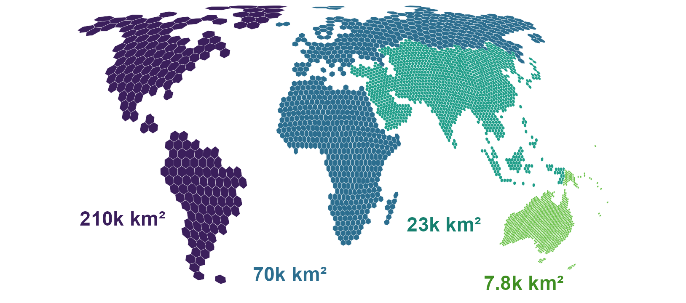

# hexify 

*equal-area hexagons covering the globe*

<!-- badges: start -->

[](https://CRAN.R-project.org/package=hexify)
[](https://cran.r-project.org/package=hexify)
[](https://cran.r-project.org/package=hexify)
[](https://github.com/gcol33/hexify/actions/workflows/R-CMD-check.yaml)
[](https://app.codecov.io/gh/gcol33/hexify)
[](https://opensource.org/licenses/MIT)
<!-- badges: end -->

<p align="center">


</p>

hexify assigns points on the globe to the cells of a hexagonal grid in
which every cell has the same area, such as species records counted in
cells of about 8,000 km² each, from the equator to the poles.

Rectangular latitude-longitude grids shrink towards the poles: a 1° cell
at 60°N has half the area of a 1° cell at the equator, so a count per
cell mixes what was found with how large the cell is. hexify builds its
grids on the Icosahedral Snyder Equal Area (ISEA) projection (Snyder
1992), the discrete global grid system of Sahr, White and Kimerling
(2003) that [dggridR](https://github.com/r-barnes/dggridR/) also
provides, and computes it in C++ with no external libraries. A grid is
set by its cell area or its resolution, and each point receives the ID
of the cell that contains it. You can then count, summarise and map your
data per cell, and choose the cell size that suits your analysis.

hexify supports:

- **Equal-area grids at any cell size.** ISEA grids take apertures 3, 4
  and 7 in any sequence up to resolution 30, and the Hex9 grid on the
  octahedron (Griffin 2026).
  [`hex_grid()`](https://gillescolling.com/hexify/reference/hex_grid.html)
  picks the resolution whose cell area is closest to the area you ask
  for.
- **H3 grids.** The bundled [H3](https://h3geo.org/) v4.4.1 C library
  builds H3 grids with no extra installation, and
  [`h3_crosswalk()`](https://gillescolling.com/hexify/reference/h3_crosswalk.html)
  maps cells between H3 and ISEA grids.
- **Cell polygons for any region.** Grids come as sf polygons over a
  bounding box, the whole globe or the outline of a country, ready for
  mapping and spatial joins.
- **Other planets and moons.** `radius_km = "mars"` sizes a grid on
  Mars, and the Moon, Titan or a sphere of any radius work the same way,
  on both backends.

The ISEA projection and cell numbering follow dggridR. The test suite
compares hexify’s cell IDs, icosahedron faces and projected coordinates
with reference tables generated by dggridR at aperture 3, and
[`as_dggrid()`](https://gillescolling.com/hexify/reference/as_dggrid.html)
and `from_dggrid()` convert grid specifications between the two
packages. A methods section can cite Snyder (1992) for the projection,
Sahr, White and Kimerling (2003) for the grid system and hexify for the
implementation.

## Installation

Install the released version from CRAN. Windows and macOS get a binary
that needs no build tools:

``` r
install.packages("hexify")
```

The development version compiles C++ and C code. Install the build tools
for your operating system first:

| Operating system | Build tools |
|----|----|
| Windows | [Rtools](https://cran.r-project.org/bin/windows/Rtools/) matching your R version |
| macOS | Run `xcode-select --install` in Terminal |
| Debian / Ubuntu | Install `r-base-dev` |

Check that R can find the compiler:

``` r
pkgbuild::has_build_tools(debug = TRUE)
```

Then install hexify from GitHub:

``` r
# install.packages("pak")
pak::pak("gcol33/hexify")
```

The H3 library ships as C source inside the package and compiles with
it, using the C99 compiler that the build tools above provide, so no
system H3 library is needed.

## Usage

1.  Assign points to cells with `hexify()`, giving the cell area in km².
2.  Build one grid with `hex_grid()` to reuse it across tables, and
    summarise per cell.
3.  Turn the cells into polygons with `cell_to_sf()` to map them or join
    them to other layers.

The input is a data frame with longitude and latitude in decimal degrees
(WGS84), in columns named `lon` and `lat` unless the `lon` and `lat`
arguments name others. An [sf](https://r-spatial.github.io/sf/) object
works in any coordinate reference system, which hexify transforms
itself.

``` r
library(hexify)

cities <- data.frame(
  city = c("Vienna", "Paris", "Madrid"),
  lon = c(16.37, 2.35, -3.70),
  lat = c(48.21, 48.86, 40.42)
)
cells <- hexify(cities, area_km2 = 10000)

out <- as.data.frame(cells)
out[, c("city", "cell_id", "cell_area_km2")]
#>     city cell_id cell_area_km2
#> 1 Vienna   14092      7774.205
#> 2  Paris   13272      7774.205
#> 3 Madrid   13260      7774.205
```

Each row receives the ID of its cell and the cell area, and the result
also holds the cell centre and diagonal. The grid uses the resolution
whose cell area is closest to `area_km2`, here 7,774 km².

A grid built once with `hex_grid()` gives the same cell IDs for every
table assigned to it, so counts from different datasets can be joined by
`cell_id`:

``` r
grid <- hex_grid(area_km2 = 20000)

set.seed(1)
occ <- data.frame(
  species = sample(c("Sp A", "Sp B", "Sp C"), 1000, replace = TRUE),
  lon = runif(1000, -10, 30),
  lat = runif(1000, 35, 60)
)
occ_hex <- hexify(occ, grid = grid)
occ_df <- as.data.frame(occ_hex)

counts <- aggregate(species ~ cell_id, data = occ_df, FUN = length)
names(counts)[2] <- "n_records"
head(counts)
#>   cell_id n_records
#> 1       1         3
#> 2      55         4
#> 3     136         3
#> 4    2211         1
#> 5    2212         3
#> 6    2213         4
```

`cell_to_sf()` returns the polygons of these cells as an sf object, to
which the counts join by `cell_id`:

``` r
polys <- cell_to_sf(counts$cell_id, grid)
polys <- merge(polys, counts, by = "cell_id")
plot(polys["n_records"])
```

## Grids over a region

`grid_rect()` covers a bounding box with cell polygons, `grid_global()`
covers the whole globe, and `grid_clip()` keeps the cells inside a
boundary such as a country outline from
[rnaturalearth](https://docs.ropensci.org/rnaturalearth/):

``` r
grid <- hex_grid(area_km2 = 50000)
europe <- grid_rect(c(-10, 35, 40, 70), grid)

france <- rnaturalearth::ne_countries(country = "France", returnclass = "sf")
france_grid <- grid_clip(france, grid)
```

[Practical
Workflows](https://gillescolling.com/hexify/articles/workflows.html)
covers shared grids across datasets, choosing a resolution and export to
GIS, and
[Visualization](https://gillescolling.com/hexify/articles/visualization.html)
builds maps with base R and ggplot2.

## H3 grids

`hex_grid(resolution = 8, type = "h3")` builds an H3 grid, which
`hexify()`, `grid_rect()` and `grid_clip()` take in place of an ISEA
grid. H3 has a fixed aperture of 7 and a maximum resolution of 15, with
cells of about 0.9 m².

H3 cells are not equal-area. Hexagon area varies by about a factor of 2
within a resolution, and by about 2.4 once the twelve pentagons are
counted. The variation follows position on the icosahedron rather than
latitude, with the smallest cells near face centres. Use ISEA where
equal area matters, and `cell_area()` to read the area of a given H3
cell. [H3 Grid
Support](https://gillescolling.com/hexify/articles/h3.html) works
through H3 grids, their hierarchy and the crosswalk to ISEA.

## Why equal-area hexagons

Hexagonal grids on the ISEA projection bring three properties to spatial
binning:

1.  Every cell covers the same surface area from equator to pole,
    because hexify places the cells with Snyder’s equal-area projection.
2.  All six neighbours of a cell share an edge and sit at the same
    distance from its centre, so neighbourhood statistics carry no
    directional bias.
3.  The hexagonal tiling has the smallest perimeter per unit area among
    partitions of a plane into equal areas ([Hales
    2001](https://doi.org/10.1007/s004540010071)), which keeps edge
    effects small.

Any hexagonal tiling of a sphere needs exactly 12 pentagonal cells, at
the vertices of the icosahedron. These cells have 5 neighbours instead
of 6, and `is_pentagon()` finds them. [Mathematical
Foundations](https://gillescolling.com/hexify/articles/theory.html)
derives the projection, the aperture sequences and the cell indexing.

## Documentation

Start with [Quick
Start](https://gillescolling.com/hexify/articles/quickstart.html):
points assigned to cells, counted per cell and mapped.

- [Practical
  Workflows](https://gillescolling.com/hexify/articles/workflows.html):
  shared grids across datasets, cell polygons, choosing a resolution and
  export to GIS.
- [Visualization](https://gillescolling.com/hexify/articles/visualization.html):
  maps with base R `plot()`, `hexify_heatmap()` and ggplot2.
- [Interactive
  Globe](https://gillescolling.com/hexify/articles/globe.html): a grid
  on a globe that turns under the mouse, drawn with `hex_globe()`.
- [H3 Grid Support](https://gillescolling.com/hexify/articles/h3.html):
  H3 grids, their hierarchy and the crosswalk to ISEA.
- [Mathematical
  Foundations](https://gillescolling.com/hexify/articles/theory.html):
  the Snyder projection, aperture quantization and cell indexing.
- [Lambert’s Construction of Snyder’s
  Projection](https://gillescolling.com/hexify/articles/lambert.html):
  the projection of one icosahedron face, followed step by step.
- [OGC Topic 21
  Conformance](https://gillescolling.com/hexify/articles/ogc-conformance.html):
  hexify against each requirement of the OGC standard for discrete
  global grid systems.
- [Full reference](https://gillescolling.com/hexify/reference/): every
  function, grouped by job.

## Getting help

Questions and bug reports go to the [GitHub
issues](https://github.com/gcol33/hexify/issues). A bug report is
easiest to act on with a small reproducible example, for instance made
with [reprex](https://reprex.tidyverse.org/).

## Support

> “Software is like sex: it’s better when it’s free.” — Linus Torvalds

I’m a PhD student who builds R packages in my free time because I
believe good tools should be free and open. I started these projects for
my own work and figured others might find them useful too.

If this package saved you some time, buying me a coffee is a nice way to
say thanks. It helps with my coffee addiction.

[](https://buymeacoffee.com/gcol33)

## Acknowledgements

The H3 grids run on the [H3](https://h3geo.org/) C library by Uber
Technologies, bundled in `src/h3`. The Hex9 address tables come from
libhex9 by Ben Griffin. The reference tables that the ISEA tests compare
against were generated with
[dggridR](https://github.com/r-barnes/dggridR/).

## License

hexify is licensed under MIT. The bundled H3 library and the Hex9
address tables are licensed under Apache-2.0; `inst/COPYRIGHTS` lists
the files and their sources.

## Citation

``` text
Colling G (2026). _hexify: Equal-Area Hex Grids on the Snyder ISEA
Icosahedron_. doi:10.32614/CRAN.package.hexify
<https://doi.org/10.32614/CRAN.package.hexify>. R package version
0.9.0, <https://gillescolling.com/hexify/>.
```

BibTeX:

``` bibtex
@Manual{colling2026hexify,
  title = {hexify: Equal-Area Hex Grids on the Snyder ISEA Icosahedron},
  author = {Gilles Colling},
  year = {2026},
  note = {R package version 0.9.0},
  url = {https://gillescolling.com/hexify/},
  doi = {10.32614/CRAN.package.hexify},
}
```

Download the citation as
[BibTeX](https://gillescolling.com/hexify/hexify.bib) or
[RIS](https://gillescolling.com/hexify/hexify.ris).
