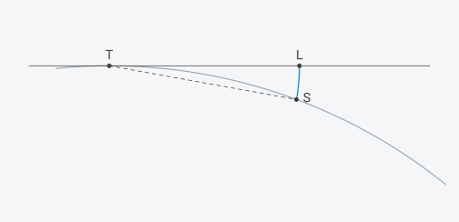
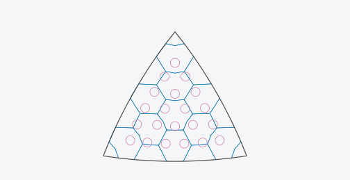
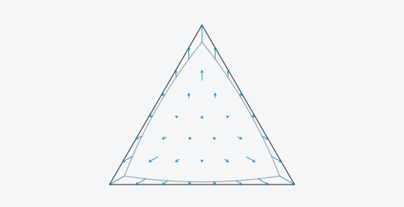
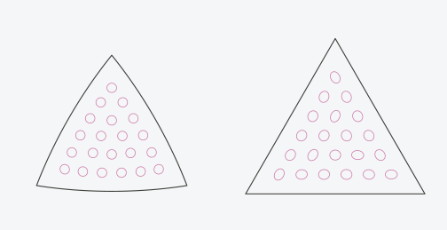
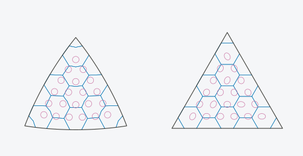
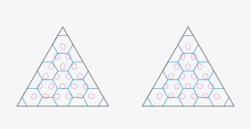

# Lambert's Construction of Snyder's Projection

Snyder’s projection (Snyder 1992) maps each face of the icosahedron, as
a spherical triangle, onto a plane triangle of the same area. Snyder
built it from Lambert’s azimuthal equal-area projection centred on the
face, and changed the azimuths and radii of that projection so that the
face fills the triangle exactly. Lambert’s projection has a construction
with compass and ruler. In this article I follow the points of one face
through that construction and through Snyder’s change of it, step by
step, with three functions:

- [`projection_stages()`](https://gillescolling.com/hexify/reference/projection_stages.md)
  returns each point’s place at every step;
- `projection_distortion(stage = )` returns Tissot’s indicatrix at every
  step;
- `hex_globe(lambert = )` draws the steps on a globe, with a slider.

The sphere has radius 1 throughout. For a face, T is its centre on the
sphere, S a point of the face, z the arc from T to S, and Az the azimuth
of S seen from T, measured from the face’s first vertex.

## Installation

``` r

# Install from CRAN
install.packages("hexify")

# Or install development version from GitHub
# install.packages("pak")
pak::pak("gcol33/hexify")
```

## One point

Lambert’s projection is built on the plane that touches the sphere at T.
The point S lies on a circle with centre T and radius \|TS\|, in the
plane that holds S and the normal of the sphere at T. S swings along
that circle down onto the touching plane, and lands at the Lambert point
L, so that

``` math
|TL| = |TS| = 2 \sin(z / 2).
```

L keeps the azimuth of S.
[`projection_stages()`](https://gillescolling.com/hexify/reference/projection_stages.md)
returns the point’s plane coordinates `u` and `v` at each step, along
the x and y axes of the face’s triangle, from the face centre:

``` r

s <- projection_stages(grid, lon = 20, lat = 40)
s[, c("face", "arc", "az", "lambert_u", "lambert_v")]
#>   face      arc      az lambert_u lambert_v
#> 1    2 20.50369 19.4326 0.1184239 0.3356732
c(TL = sqrt(s$lambert_u^2 + s$lambert_v^2), chord = 2 * sin(s$arc * pi / 360))
#>        TL     chord 
#> 0.3559504 0.3559504
```

The figure shows the construction in the plane of S, T and the sphere’s
centre: the sphere’s circle, the touching plane at T (the horizontal
line at height 1), and the circle about T that S swings along.



## One face

Every point of the face swings down the same way. The face lands on the
touching plane as a triangle whose edges are curved: its corners lie at
distance 0.6409 from T, and the middle of each edge farther out than the
straight line between two corners. Lambert’s projection is equal-area,
so this curved triangle has the face’s area, `4 * pi / 20` = 0.6283, and
every cell keeps its area.



The ellipses are Tissot’s indicatrices: the images of small circles of
equal size on the sphere. On Lambert’s projection, at arc z from the
centre, a circle is stretched by $`1 / \cos(z / 2)`$ across the radius
and shrunk by $`\cos(z / 2)`$ along it, so its area does not change:

``` r

corner <- projection_stages(grid, lon = 11.25, lat = 58.282525588538995, face = 0L)
d <- projection_distortion(grid, c(20, 11.25), c(40, 58.282525588538995), stage = "lambert")
d[, c("a", "b", "areal", "angular")]
#>          a         b areal  angular
#> 1 1.016224 0.9840350     1 1.844139
#> 2 1.055661 0.9472736     1 6.204086
```

The second row is a corner of the face (a vertex of the icosahedron, z =
37.38 degrees), where Lambert’s projection deforms angles most on the
face, by 6.2 degrees.

Cells that lie wholly on the face keep their area on the curved
triangle. For this grid’s hexagons on the face, their areas there over
their areas on Snyder’s plane triangle, which are their areas on the
sphere:

``` r

paths <- hexify:::grid_surface_paths(grid, NULL, 0.002)
rows <- split(seq_len(nrow(paths)), paths[, "cell"])
inside <- vapply(rows, function(i) all(paths[i, "face"] == 0), logical(1))
inside <- inside & !is_pentagon(as.numeric(names(rows)), grid)
sum(inside)
#> [1] 5
cell_area <- function(i, stage) {
  ll <- hexify:::vec_lonlat(paths[i, c("sphere_x", "sphere_y", "sphere_z")])
  st <- projection_stages(grid, ll[, 1], ll[, 2], face = 0L)
  u <- st[[paste0(stage, "_u")]]
  v <- st[[paste0(stage, "_v")]]
  abs(sum(u * c(v[-1], v[1]) - c(u[-1], u[1]) * v)) / 2
}
range(vapply(rows[inside], cell_area, numeric(1), stage = "lambert") /
        vapply(rows[inside], cell_area, numeric(1), stage = "snyder"))
#> [1] 0.9999848 1.0000005
```

The walls are drawn through points 0.002 radians apart on the sphere,
and the ratios differ from 1 by that sampling only.

The edges of the curved triangle are not those of a plane triangle, so
the faces of the icosahedron do not fit together on Lambert’s
projection, and cells there that cross a face edge do not close up.

## The nudge

Snyder changes Lambert’s projection within the touching plane. He moves
the point from the azimuth Az to an azimuth Az’ and multiplies its
radius by a factor f, which depends on the azimuth only:

``` math
\rho = 2 f \sin(z / 2).
```

He chooses Az’ so that the ray from the centre at Az’ cuts off as much
area of the plane triangle as the ray at Az cuts off of the face, in
each of the six right triangles between the centre, a corner and the
middle of an edge (Snyder 1992, eqs. 6 to 11), and f so that the face
edge lands on the triangle’s edge. I call the new point N, the nudged
point. The figure shows the curved triangle in grey and the straight one
the nudge makes of it, with an arrow from L to N at points of the face.



How far the nudge moves the points, over a lattice of points 60 steps to
a face edge. Snyder’s projection is equal-area, so a lattice on the
plane triangle spreads the points evenly over the face’s area:

``` r

ll <- face_lattice(grid, 60)
dense <- projection_stages(grid, ll[, 1], ll[, 2], face = 0L)
r1 <- attr(dense, "r1")
edge <- sqrt(16 * pi / (sqrt(3) * 20)) / r1
moved <- sqrt((dense$nudge_u - dense$lambert_u)^2 +
              (dense$nudge_v - dense$lambert_v)^2) / edge
turn <- abs((dense$az_prime - dense$az + 180) %% 360 - 180)
c(largest = max(moved), mean = mean(moved), largest_turn_deg = max(turn))
#>          largest             mean largest_turn_deg 
#>       0.09301926       0.03064207       1.90403522
```

`moved` is \|LN\| over the edge of the nudged triangle. The largest is
at the corners. `paper/bench/bench_lambert_nudge.R` measures the same
over 20,301 points and on the octahedron. The nudge moves the corners by
about a tenth of an edge, which shows on a globe without magnification,
and the points near the centre by much less.

The nudge keeps areas in proportion: the nudged triangle has
$`1 / R'^2`$ = 1.2066 times the face’s area, everywhere on it. It does
not keep the shape of Tissot’s ellipses. Snyder’s projection bends along
the three lines from the centre to the corners (Snyder 1992, p. 11): the
ellipses on the two sides of such a line differ, and a line on the
sphere that crosses it gets a kink there.



On the left Lambert’s ellipses, on the right those after the nudge, at
the same points. The largest angular deformation after the nudge is at
the centre, approached along the lines to the corners, 17.27 degrees
(Snyder 1992, Table 1):

``` r

centre <- hexify:::cpp_face_xy_to_ll(hexify:::icosa_arg(grid), 0.5,
                                     1 / (2 * sqrt(3)) + 1e-7, 0L)
projection_distortion(grid, centre[1], centre[2], stage = "nudge")[, c("a", "b", "angular")]
#>          a         b  angular
#> 1 1.277792 0.9442593 17.26559
```

## The scaling

The last step scales the touching plane about the sphere’s centre by
$`R'`$ = 0.9104. This takes the plane at distance 1 from the centre onto
the face plane, at distance $`R'`$, and the nudged triangle onto the
plane triangle with the face’s area. It is Snyder’s projection:
$`\rho = 2 R' f \sin(z / 2)`$. The scaling multiplies every length by
$`R'`$, so Tissot’s ellipses keep their shape and the areal scale
becomes 1.



The last step is the forward projection itself: `tx` and `ty` of
[`projection_stages()`](https://gillescolling.com/hexify/reference/projection_stages.md)
are the triangle coordinates
[`hexify_forward()`](https://gillescolling.com/hexify/reference/hexify_forward.md)
gives.

``` r

p <- hexify_forward(20, 40)
c(p[["icosa_triangle_x"]] - s$tx, p[["icosa_triangle_y"]] - s$ty)
#> [1] 0 0
```

## Fuller’s projection beside it

Fuller’s projection (`projection = "fuller"`) maps the same face onto
the same triangle without Lambert’s projection behind it, and is not
equal-area. The figure shows the face under Snyder’s projection (left)
and Fuller’s (right), with Tissot’s ellipses of each at the same points.



Over 5,000 random points of the sphere, the range of the areal scale and
the largest angular deformation of each:

``` r

set.seed(1)
lon <- runif(5000, -180, 180)
lat <- asin(runif(5000, -1, 1)) * 180 / pi
df <- projection_distortion(fuller, lon, lat)
ds <- projection_distortion(grid, lon, lat)
rbind(snyder = c(range(ds$areal), max_angular = max(ds$angular)),
      fuller = c(range(df$areal), max_angular = max(df$angular)))
#>                           max_angular
#> snyder 1.0000000 1.000000    17.14866
#> fuller 0.9506552 1.076505    13.06439
```

## All faces

On the globe every face swings down onto its own touching plane, so the
faces come apart along their edges, and the gaps close again only on the
solid. `hex_globe(lambert = )` opens the globe at a step of the
construction, from 0 (the sphere) through 1 (the Lambert points) and 2
(the nudged points) to 3 (the faces); the slider moves along it. The
globes need a browser with WebGPU (see the [Interactive
Globe](https://gillescolling.com/hexify/articles/globe.md) article).

``` r

hex_globe(grid, lambert = 1, center = c(lon = 20, lat = 40),
          width = "100%", height = 560)
```

At step 1 the curved triangles of the faces leave gaps between them, and
coastlines and cell walls stop at the face edges. Moving the slider to 2
straightens the edges; at 3 the faces close into the icosahedron whose
faces have the area of theirs on the sphere, whose corners lie 1.1456
radii from the centre, outside the sphere.

## One path

The menu beside the slider switches from the three steps to one path per
point: the angle below the touching plane, the azimuth, the radius and
the height of the plane change together, so that the point leaves S
along the compass circle and lands on Snyder’s point.

``` r

hex_globe(grid, lambert = 0, lambert_path = "single", land = TRUE,
          width = "100%", height = 560)
```

## Earlier pictures of the construction

Wikipedia’s article on Lambert’s projection describes the construction
with the circle centred at the point of tangency and draws it in a
cross-section figure; it also has an animation in which the sphere opens
at a pole into a disc while every cell of a grid keeps its area
(<https://en.wikipedia.org/wiki/Lambert_azimuthal_equal-area_projection>,
read 2026-10-10). Snyder (1992) describes his projection as Lambert’s
azimuthal equal-area projection with the azimuths and the radial
distances adjusted. In web searches on 2026-10-10 I did not find an
animation that carries out Lambert’s construction face by face on a
polyhedron or shows Snyder’s adjustment as a step of its own.

## Reference

Snyder, J. P. (1992). An equal-area map projection for polyhedral
globes. *Cartographica* 29(1), 10-21.
<https://doi.org/10.3138/27H7-8K88-4882-1752>
